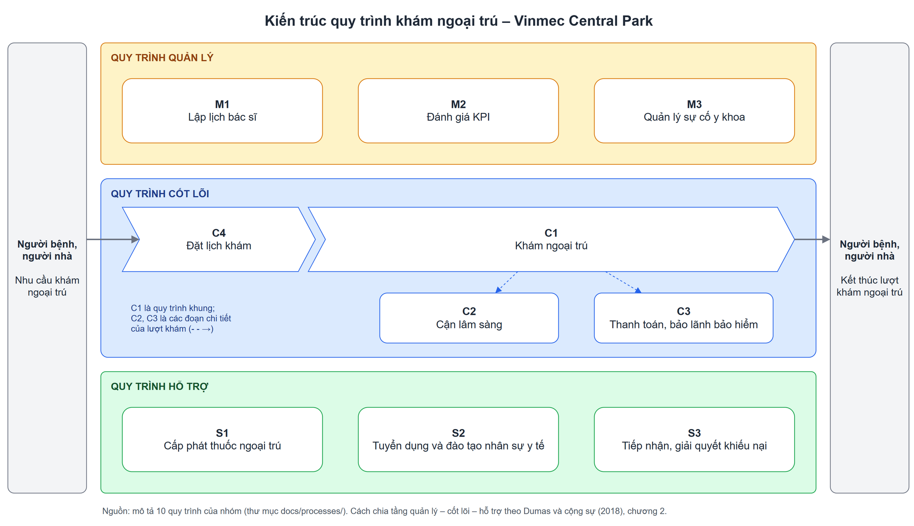

# Kiến trúc quy trình 3 tầng

- File gốc: `architecture.drawio` (mở bằng draw.io), ảnh: `architecture.png`.
- Phạm vi: khu khám ngoại trú Vinmec Central Park, 10 quy trình chia 3 tầng **quản lý (M1–M3), cốt lõi (C1–C4),
  hỗ trợ (S1–S3)** theo mục tiêu đề tài (`report/sections/01-gioi-thieu.md`, mục 1.4).
- Tên, loại và liên kết lấy từ mô tả quy trình trong `docs/processes/`.
- Phân loại quy trình quản lý, cốt lõi, hỗ trợ và mô hình bức tranh quy trình (process landscape) theo Dumas, La Rosa,
  Mendling, Reijers (2018), *Fundamentals of Business Process Management*, 2nd ed., Springer, chương 2
  "Process Identification".

*Hình 1. Kiến trúc quy trình 3 tầng khu khám ngoại trú Vinmec Central Park*

Hình 1 là bức tranh tổng quan (process landscape): chỉ thể hiện 10 quy trình theo 3 tầng và chuỗi cốt lõi C4 → C1
(C2, C3 là đoạn chi tiết của C1). Liên kết giữa các quy trình không vẽ trên hình mà ghi ở Bảng 2.

## Danh sách quy trình

**Bảng 1. Danh sách 10 quy trình theo tầng**

| Tầng | Mã | Quy trình | Mô tả |
|---|---|---|---|
| Quản lý | M1 | Lập lịch bác sĩ | `docs/processes/M1-lap-lich-bac-si.md` |
| Quản lý | M2 | Đánh giá KPI | `docs/processes/M2-danh-gia-kpi.md` |
| Quản lý | M3 | Quản lý sự cố y khoa | `docs/processes/M3-quan-ly-su-co-y-khoa.md` |
| Cốt lõi | C4 | Đặt lịch khám | `docs/processes/C4-dat-lich.md` |
| Cốt lõi | C1 | Khám ngoại trú | `docs/processes/C1-kham-ngoai-tru.md` |
| Cốt lõi | C2 | Cận lâm sàng | `docs/processes/C2-can-lam-sang.md` |
| Cốt lõi | C3 | Thanh toán, bảo lãnh bảo hiểm | `docs/processes/C3-thanh-toan-bao-hiem.md` |
| Hỗ trợ | S1 | Cấp phát thuốc ngoại trú | `docs/processes/S1-cap-phat-thuoc.md` |
| Hỗ trợ | S2 | Tuyển dụng và đào tạo nhân sự y tế | `docs/processes/S2-tuyen-dung-dao-tao.md` |
| Hỗ trợ | S3 | Tiếp nhận, giải quyết khiếu nại | `docs/processes/S3-khieu-nai.md` |

## Cách đọc sơ đồ

- **Cốt lõi:** người bệnh có nhu cầu khám → **C4** đặt lịch (kết thúc ở check-in) → **C1** khám ngoại trú → ra về.
  C1 là quy trình khung; **C2** (cận lâm sàng) và **C3** (thanh toán, bảo lãnh) là các đoạn chi tiết của lượt khám,
  vẽ bằng mũi tên nét đứt. Người bệnh đến trực tiếp không hẹn trước thì bắt đầu thẳng từ C1 (C1 đánh ⚠, câu 1).
- **Quản lý:** lập lịch bác sĩ (M1), đánh giá KPI (M2), quản lý sự cố y khoa (M3).
- **Hỗ trợ:** cấp phát thuốc (S1), tuyển dụng và đào tạo nhân sự (S2), giải quyết khiếu nại (S3).

## Liên kết giữa các quy trình

Theo mục "Liên kết với quy trình khác" trong từng mô tả.

**Bảng 2. Liên kết giữa các quy trình**

| Từ | Đến | Nội dung |
|---|---|---|
| M1 | C4 | Lịch làm việc của bác sĩ là khung giờ có thể đặt; đổi lịch bác sĩ kích hoạt liên hệ đổi lịch |
| M1 | C1 | Số bác sĩ mỗi buổi quyết định thời gian chờ khám |
| C4 | C1 | C4 kết thúc ở check-in, định danh; C1 bắt đầu từ đó |
| C1 | C2 | Bác sĩ chỉ định cận lâm sàng, nhận lại kết quả để đọc |
| C1, C2 | C3 | Khai báo hình thức chi trả, thanh toán chỉ định, thanh toán cuối lượt khám |
| C4 | C3 | Thông tin bảo hiểm có thể được hỏi trước khi đến ⚠ (theo C3) |
| C1 | S1 | Đơn thuốc của lượt khám là sự kiện bắt đầu cấp phát thuốc |
| C1, C2, S1 | M3 | Nơi phát sinh sự cố (nhầm người bệnh, nhầm mẫu, nhầm thuốc) |
| C3 | S3 | Tranh chấp bảo lãnh hoặc chi phí |
| M3 | S3 | Khiếu nại có thể là nguồn phát hiện sự cố; sự cố có thể dẫn tới khiếu nại |
| M3 | S2 | Đào tạo lại là giải pháp khắc phục sự cố |
| C1–C4, S1, S3, M1, M3 | M2 | Cung cấp dữ liệu cho KPI (thời gian chờ, no-show, tỉ lệ từ chối bảo lãnh, số sự cố…) |
