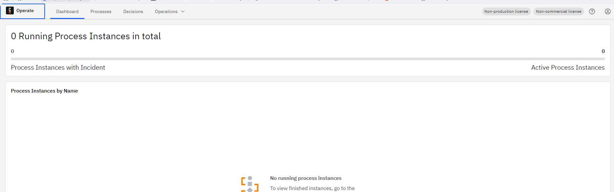

# T30 – Kiểm thử Camunda 8 local

Ngày 27/11/2026, chạy trên Windows với Docker Desktop 4.100.1 và WSL 2.
Các lệnh dưới đây chạy từ thư mục `infra/`.



```text
> docker compose pull
Image camunda/camunda:8.9.30 Pulled

> docker compose up -d --wait --wait-timeout 180
Container infra-camunda-1 Healthy

> docker compose ps
NAME              IMAGE                    COMMAND                  SERVICE   CREATED          STATUS                    PORTS
infra-camunda-1   camunda/camunda:8.9.30   "/usr/local/camunda/…"   camunda   35 seconds ago   Up 31 seconds (healthy)   127.0.0.1:8080->8080/tcp, 127.0.0.1:26500->26500/tcp

> curl.exe --fail-with-body --silent --show-error http://localhost:8080/v2/topology
{"brokers":[{"nodeId":0,"host":"172.18.0.2","port":26501,"partitions":[{"partitionId":1,"role":"leader","health":"healthy"}],"version":"8.9.30"}],"clusterId":"f371cb4a-aeb4-4532-801a-b0d38b6fec96","clusterSize":1,"partitionsCount":1,"replicationFactor":1,"gatewayVersion":"8.9.30","lastCompletedChangeId":"-1"}
```
